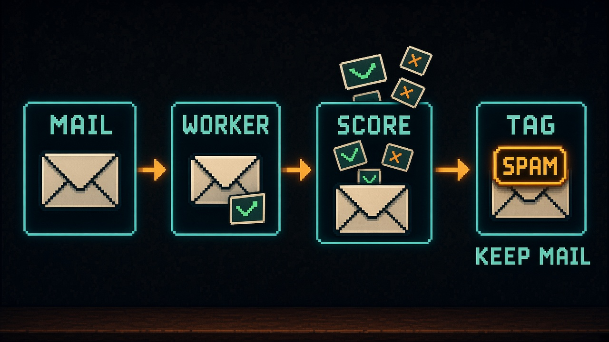
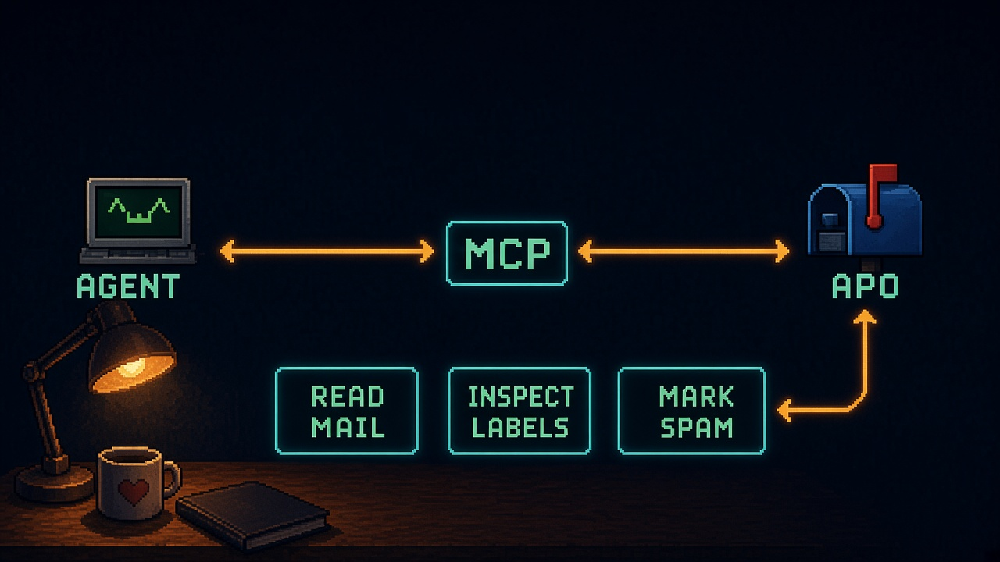

[Agent Post Office](https://agentpostoffice.com/) is my Cloudflare mailbox for agents. Inbound mail hits Email Routing, a Worker stores and parses it with D1, R2, and Queues, and agents talk to it through REST, a CLI, or MCP. Outbound mail leaves through Email Sending. The same Worker serves `POST /mcp`.

Four real spam emails arrived. They were cold B2B pitches: an SEO audit offer, a downtime-outreach pitch, and a fake email verification. All four passed DKIM and DMARC. Cloudflare Email Routing reports SPF, DKIM, and DMARC results on inbound mail and leaves spam scoring to the Worker.

<!-- more -->

## What I tried first

I looked for a scorer that would run inside the Worker.

SpamGuard (MIT) scored one of the cold pitches at 0.3. formshield-ai is built for forms, not inbound mail. spamscanner is BUSL and needs `node:fs`. rspamd and SpamAssassin expect a server. I did not find a JS or WASM port of either. Naive Bayes libraries can run in a Worker.

I evaluated SpamAssassin's Apache-2.0 rule set as pure content scoring. Of 2,976 rules, 1,536 translated. Only 322 of those add to the score. On SpamAssassin's public test set of 4,146 messages, that translated subset caught 14.7% of the spam. The 14.7% figure covers that translated subset only. All four of my real spam emails scored 0 with it.

SpamAssassin usually leans on network lookups and learning along with static content rules. I left the translated rules out of the shipped filter. They stay a possible optional add-on later.

## What I shipped

I wrote content rules from the spam Agent Post Office received. The shipped filter combines those rules with authentication signals and per-inbox learning. Scoring is additive and capped at 100. The default threshold is 60, configurable instance-wide through `SPAM_THRESHOLD` or per inbox. Per-inbox modes are `tag`, `quarantine`, or `off`.

Auth failures contribute fixed points: DMARC failure adds 40, SPF failure adds 20, DKIM failure adds 20. One auth failure stays under the default threshold of 60. Content rules are capped at 19 points each. Block and allow lists come from my own marks.

A per-inbox Bayes layer is built from those marks. It turns on only after 20 spam marks and 20 not-spam marks, needs 90% confidence, and is capped at 52 points. Fresh inboxes have no trained Bayes score yet.

The live path runs in tag mode. It labels spam and keeps the mail. Marking spam as an operator moves the message to the spam folder, including when automatic mode is only tagging.

I deployed it to three instances. In a live check, a test spam message scored 93 and was labeled. A normal message scored 0. That is one smoke test of the scoring path.

The scorer is open source as [Agent-Post-Office/agent-post-office-spam-filter](https://github.com/Agent-Post-Office/agent-post-office-spam-filter), Apache-2.0, starting at v0.1.0.

## MCP for the mailbox

Agents call MCP tools on the Worker.

1. `poll_messages` reads the inbox feed. Pass `folder` as `inbox`, `spam`, or `all` when the spam folder should be included.
2. `get_message` inspects one message. The result includes folder plus spam verdict, score, and reasons. Content is untrusted plain text. HTML is omitted unless you ask for it.
3. `mark_spam` or `mark_not_spam` records the operator decision. Optional flags can also block or allow a sender or domain.

That path is read, inspect labels, then mark. Sending and replying are separate tools with their own scopes. They sit outside this loop.

I use that MCP surface from Grok Bot against live Agent Post Office inboxes. It is also useful for Muse and Instinct.
